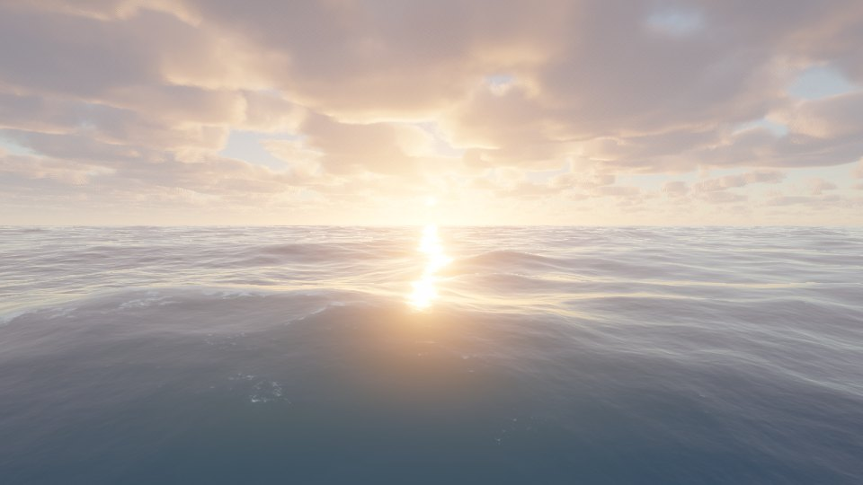

# Blue Planet — Orbit to Abyss

A real-time WebGPU descent from orbit to the abyssal seafloor, in a single HTML file.

**[Open it →](https://sahmett.github.io/onefile-worlds/orbit-to-abyss/)**

[Türkçe aşağıda ↓](#türkçe)

## What you can do

- **Fly from space to the seafloor without a cut.** The planet is real scale: the atmosphere, clouds, ocean surface and underwater scene are one continuous world.
- **Take the cinematic tour.** About three minutes from orbit, through the clouds, across the waves, over the reef and down the reef wall to the vents, with layer cards along the way.
- **Change the time of day.** Sunrise, noon, sunset and a moonlit night; time can also run on its own.
- **Choose the weather.** Clear, few clouds, partly cloudy or overcast.
- **Read the layer guide.** Cards for each layer (exosphere, thermosphere, mesosphere, stratosphere, troposphere, sea surface, sunlight, twilight and midnight zones, reef wall, abyssal plain) with live pressure, temperature and light readings.

## How it works

| Part | Technique |
|---|---|
| Atmosphere | Single scattering with a transmittance LUT, a sky-view LUT, ozone and maritime haze |
| Clouds | Volumetric cumulus layer with self-shadowing and a fibrous high cirrus deck; global coverage map with cyclone swirls |
| Waves | Tessendorf FFT, 6 cascades (1.1 km down to ~1 cm), JONSWAP + Donelan–Banner spectrum with swell, choppy displacement |
| Sea surface shading | LEAN-filtered slope statistics with covariance, Smith masking, visible-facet reflection tilt, foam where the whole surface folds |
| Water colour | Computed from the same water optics as the underwater view: single scattering in the water column plus the visible seafloor in shallow water |
| Underwater | Raymarched seafloor with procedural corals, caustics, light shafts, Snell's window, boids fish schools, bioluminescence, jellyfish, black-smoker vents |
| Light | Sun by day, full moon at night, continuous auto-exposure, AgX tone mapping, bloom |
| Sound | Fully procedural Web Audio: wind, waves, splash, bubbles, whale calls, deep drone |

## Controls

| Input | Action |
|---|---|
| Drag | Look around |
| W A S D | Move |
| E / Q | Up / down |
| Shift / Alt | Fast / slow |
| Wheel | Zoom in / out |
| `[` `]` | Clock ±30 min |
| T | Time flow speed |
| L | Searchlight |
| P | Cinematic tour |
| I | Layer guide |
| M | Sound |
| H | Hide the interface |

URL options: `#space`, `#clouds`, `#surface`, `#under`, `#reef`, `#wall`, `#abyss` jump to a place; `?ui=0` hides the interface; `?prof` shows GPU timings per pass.

## Requirements

A browser with WebGPU (recent Chrome or Edge, Safari 26+) and a reasonably capable GPU. If it runs slowly, pick **Fast** in Settings → Quality.

## Credits

Some ocean techniques (the JONSWAP/Donelan–Banner spectrum, LEAN slope moments, Smith masking, the visible-facet reflection tilt and wind gusts) are adapted from [Noniv/web-ocean](https://github.com/Noniv/web-ocean), MIT licensed.

---

## Türkçe

Yörüngeden abisal deniz tabanına gerçek zamanlı bir WebGPU inişi, tek bir HTML dosyasında.

**[Aç →](https://sahmett.github.io/onefile-worlds/orbit-to-abyss/)**

### Neler yapabilirsin

- **Uzaydan deniz tabanına kesintisiz in.** Gezegen gerçek ölçekte; atmosfer, bulutlar, deniz yüzeyi ve su altı tek bir sürekli dünya.
- **Sinematik turu izle.** Yaklaşık üç dakika: yörüngeden bulutların arasından dalgalara, resifin üstünden resif duvarı boyunca bacalara; yol boyunca katman kartları.
- **Günün saatini değiştir.** Gün doğumu, öğle, gün batımı ve ay ışığında gece; zaman kendiliğinden de akabilir.
- **Havayı seç.** Açık, az bulutlu, parçalı bulutlu ya da kapalı.
- **Katman rehberini oku.** Her katman için kart ve canlı basınç, sıcaklık ve ışık değerleri.

### Gereksinimler

WebGPU destekleyen bir tarayıcı (güncel Chrome veya Edge, Safari 26+) ve makul bir ekran kartı. Yavaş çalışırsa Ayarlar → Kalite'den **Hızlı**'yı seç.

### Teşekkür

Bazı okyanus teknikleri (JONSWAP/Donelan–Banner spektrumu, LEAN eğim momentleri, Smith maskelemesi, görünen dalga yüzlerine göre yansıma eğimi ve rüzgâr esintileri) MIT lisanslı [Noniv/web-ocean](https://github.com/Noniv/web-ocean) projesinden uyarlanmıştır.
